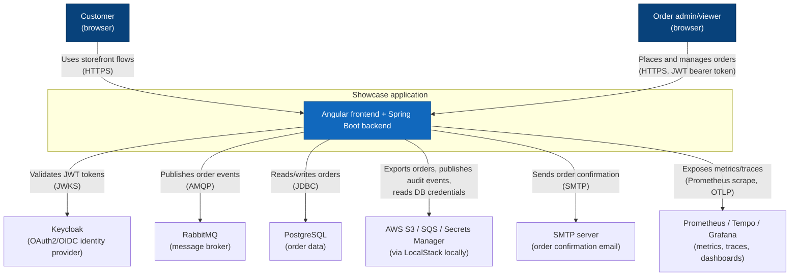
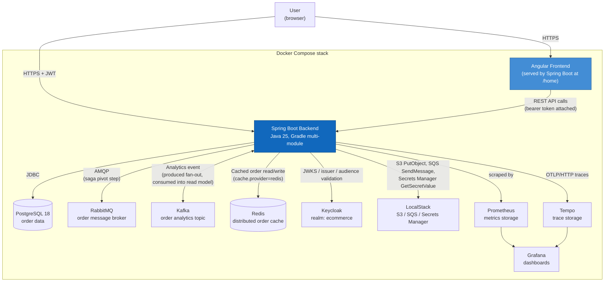
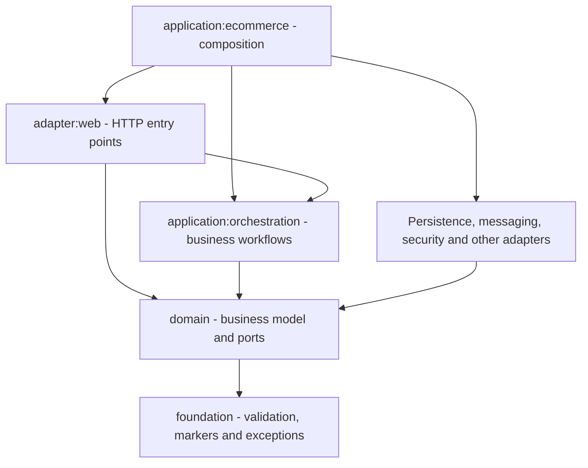
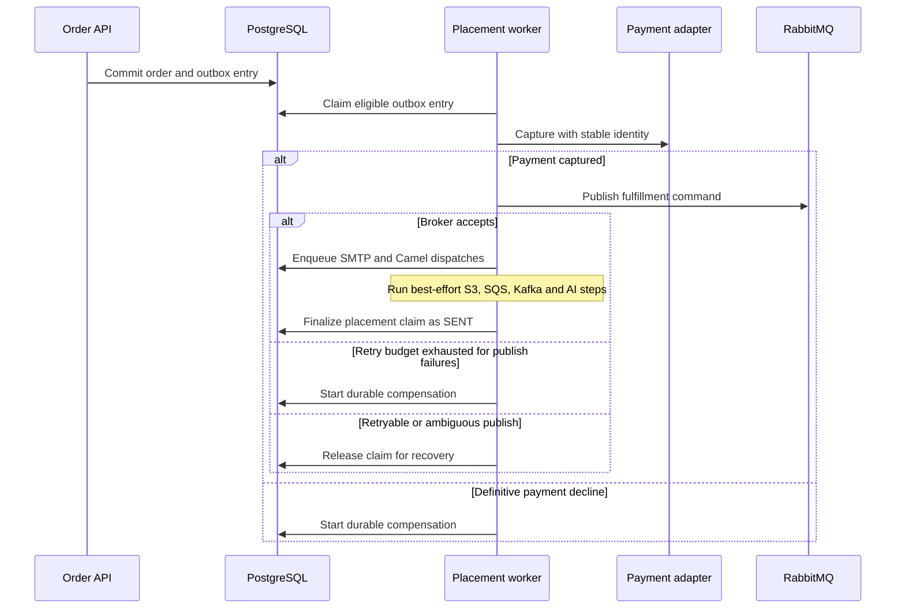

# Architecture diagrams

C4-style diagrams (context, container, and component level), plus one dynamic view of the
order-placement saga. The application is a modular monolith that serves Angular from Spring Boot.
See the [ADR index](adr/README.md) for the decisions behind these boundaries and
[`settings.gradle`](../settings.gradle) for the Gradle module-to-directory map.

## System context

Who/what interacts with the system, and which external systems it depends on.

## Containers

The diagram shows major components of the [Compose stack](../docker-compose.yml).
LocalStack is optional. Loki and Alloy collect logs as described in [Operations](operations.md).

## Backend module structure (hexagonal architecture)

The [Gradle settings](../settings.gradle) map modules to directories. The backend composes
adapters and application workflows. Domain and foundation remain independent of Spring and adapters.

| Module | Responsibility |
|---|---|
| `foundation` | Framework-neutral shared types used by domain and adapters |
| `domain` | Aggregates, domain use cases and incoming/outgoing ports |
| `application:orchestration` | Order placement and cancellation, returns and shipment workflows with transaction boundaries |
| `adapter:web` | HTTP mapping, operator identity, rate limiting and representations |
| Technical adapters | Port implementations, persistence and infrastructure integration |
| `application:ecommerce` | Spring Boot composition and runtime configuration |

The persistence adapter also owns durable saga, dispatch and reconciliation workers alongside
their repositories and claims. See [placement](#order-placement-saga) and the
[recovery runbooks](operations.md#recovery-runbooks) for their transaction and retry boundaries.

The architecture tests enforce adapter independence across module roots. Shared `adapter:common`
utilities remain available to every adapter. Web controllers may use the security adapter's
`CurrentOperatorProvider` for operator audit identity. The rule limits this exception to that class.
See [ADR 0001](adr/0001-hexagonal-architecture.md) for the original decision.

## Order placement saga

Order placement writes the order, stock reservation and `PENDING` outbox entry in the
placement transaction. The HTTP request completes once the transaction commits. A scheduled
worker claims eligible records with leases, captures payment and publishes the RabbitMQ
fulfillment command. A deterministic payment decline or exhausted retry budget for failed
publishes starts durable compensation. An unknown publish outcome follows the recovery
path for ambiguous delivery.

After an accepted publish, the saga enqueues durable SMTP and Camel dispatches. Independent
S3, SQS, Kafka and AI steps run on virtual threads as best-effort work. The saga then marks
its placement claim sent. RabbitMQ broker acceptance and the consumer's business commit
are separate milestones.

The publisher is enabled by default through `outbox.publisher.enabled`. It polls every
`outbox.publisher.poll-interval-ms` (default `5000`).
`outbox.publisher.max-fulfillment-attempts` (default `5`) bounds counted fulfillment failures. See
[ADR 0009](adr/0009-order-placement-saga.md) for the original design,
[ADR 0013](adr/0013-virtual-thread-fan-out-over-structured-concurrency-preview.md) for the executor choice,
and [ADRs 0041](adr/0041-durable-compensation-and-notification-retry.md) and
[0042](adr/0042-leased-outbox-claims.md) for durable recovery and claims. The
[external delivery runbook](runbooks/order-placement-external-delivery.md) explains ownership
of retries and replay identities.

## Event streaming (Kafka)

| Channel | Purpose | Consumption model |
|---|---|---|
| RabbitMQ | Fulfillment command | One logical downstream processor with a durable receipt |
| AWS SQS | Optional order audit event | Point-to-point audit queue |
| Kafka | Order analytics event | Replayable log with independent consumer groups |

The [AsyncAPI contract](contracts.md) defines the event shapes. The Kafka producer publishes
to `com.cp.e.topic.order.analytics`, with three partitions and the order number as the key.
Publishing runs in the best-effort tail. The `local` and `docker` topologies in
[Local development](development.md) include Kafka.

### Order analytics read model (Kafka consumer)

Consumer group `ecommerce-order-analytics` writes a projection for each supported event.
A duplicate order number leaves the existing projection intact. Unsupported schema versions
are logged and skipped. Processing failures use the configured retry and dead-letter topic.
See [ADR 0018](adr/0018-kafka-consumer-error-handling.md) and the
[consumer configuration](../modules/adapters/kafka/src/main/java/com/cp/ecommerce/adapter/kafka/configuration/KafkaErrorHandlingConfiguration.java).

Operators with `ORDER_READ` can query `GET /api/order/analytics/recent?limit=` for recent
projections in a HAL collection. The collection is empty when no events have been consumed.

## Order fan-out and routing (Apache Camel)

`OrderNotificationRoutes` receives orders on `direct:orderNotification`. A wire tap copies
the message to `direct:orderNotificationAudit`. A content-based router sends the order to
the domestic or international fulfillment route using `service.camel.domestic-country-code`
(default `PL`). The routes write JSON under `service.camel.notification-directory`, which
defaults to a directory under the OS temp directory.

`service.camel.enabled` defaults to `true`. The durable dispatch worker owns retries and
calls the routing adapter once per attempt. See [ADR 0008](adr/0008-apache-camel-for-order-notification-routing.md)
and the [external delivery runbook](runbooks/order-placement-external-delivery.md).

## Caching

`OrderEntityRepository` caches order-number lookups and updates the entry on save.
`cache.enabled` controls caching. `cache.provider` selects local Ehcache or shared Redis.
Docker and Kubernetes use Redis, which shares order cache entries across application
instances. See [ADR 0010](adr/0010-redis-opt-in-distributed-cache.md).

## Technology map

| Area | Main components |
|---|---|
| Application | Java 25, Spring Boot, Angular, Spring Security and Keycloak |
| Persistence | Hibernate, Liquibase, PostgreSQL, H2 in tests, Ehcache and Redis |
| Messaging and routing | RabbitMQ, Kafka, Camel and optional AWS adapters |
| Documents and mail | Apache FOP, FreeMarker and Jakarta Mail |
| Operations | Resilience4j, Micrometer, OpenTelemetry, Prometheus, Grafana, Tempo, Loki and Alloy |
| AI | Spring AI and optional Ollama |
| Build and verification | Gradle, Lombok, ArchUnit, Testcontainers, PIT, Playwright and GitHub Actions |

See [Deployment](deployment.md) for Docker, Helm and Terraform. See [Testing and CI](testing.md)
for quality plugins and verification commands.

## Cross-cutting concerns

The [API guide](api.md) covers authorization, Problem Details, idempotency and HAL responses.
The [operations guide](operations.md) covers observability, outbound resilience and rate limiting.
